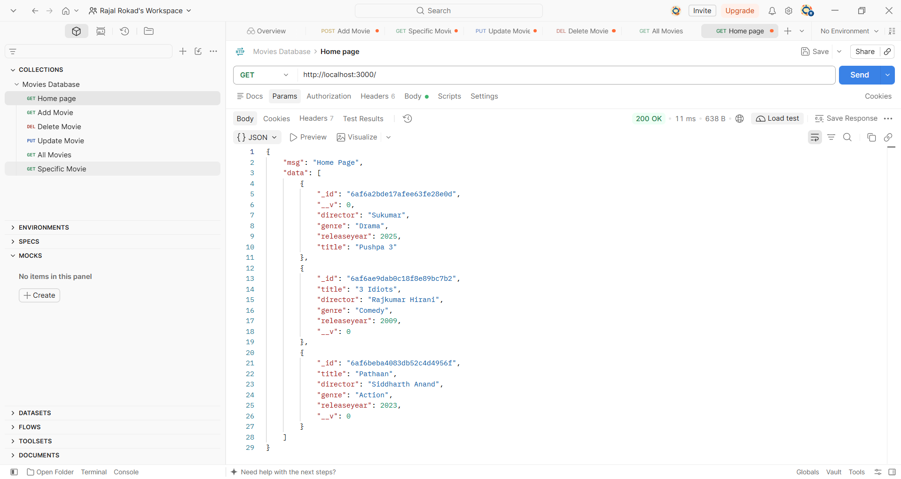
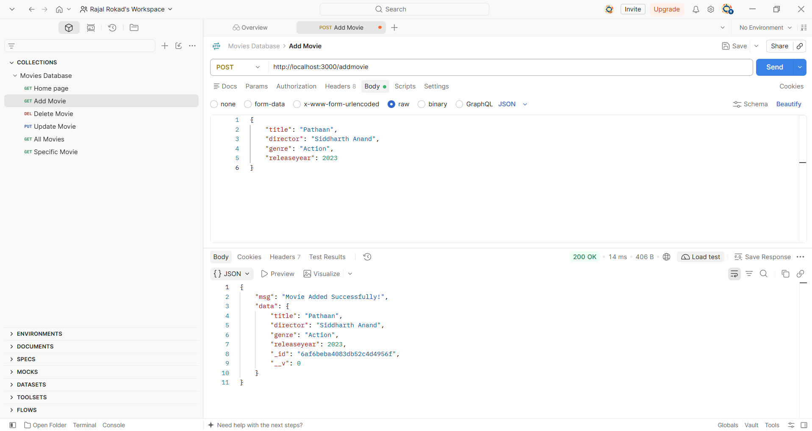
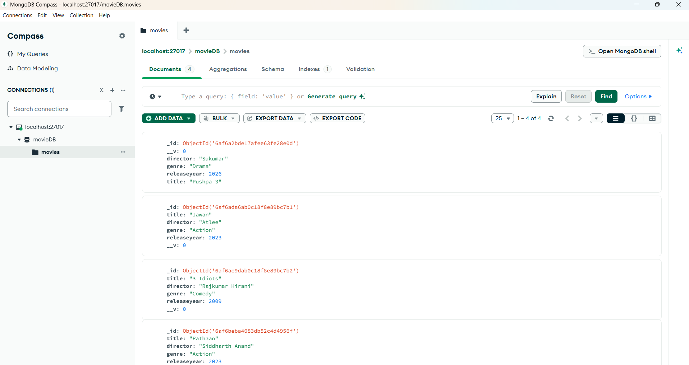
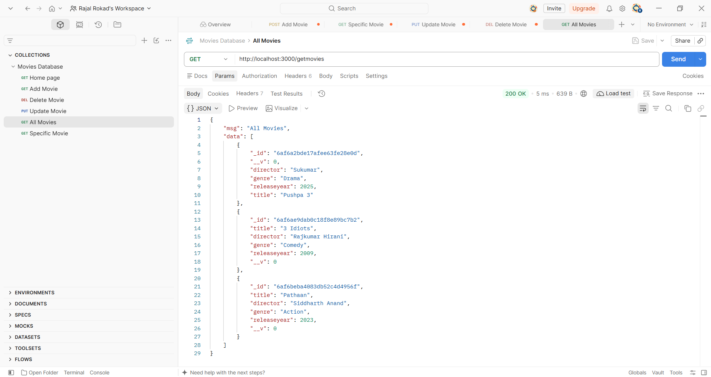
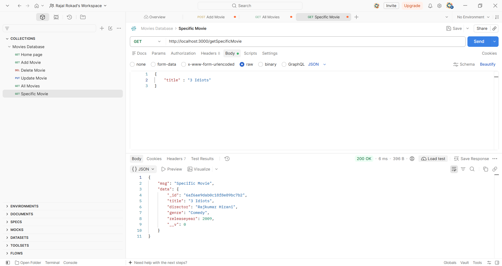
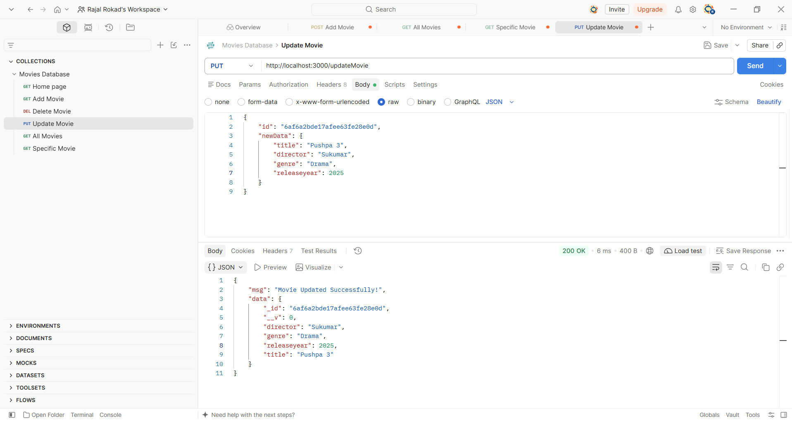
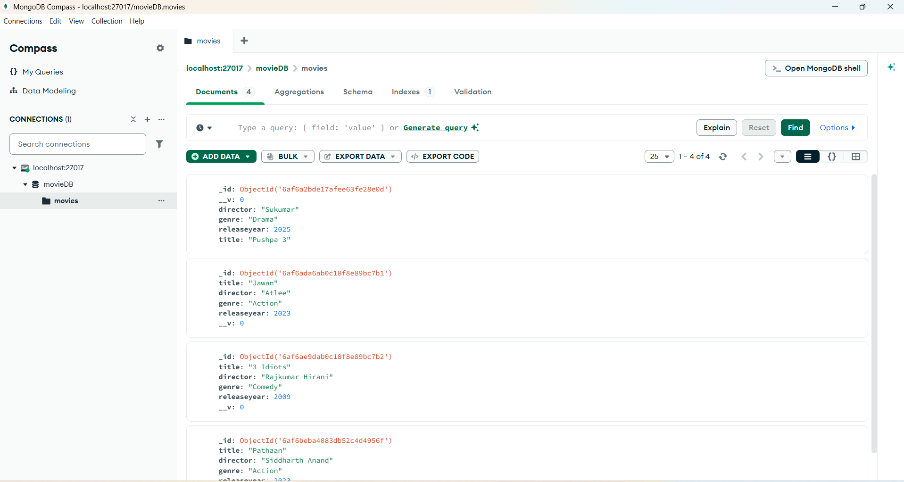
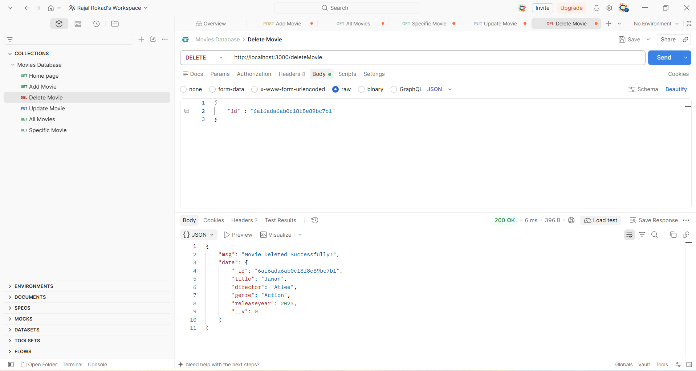
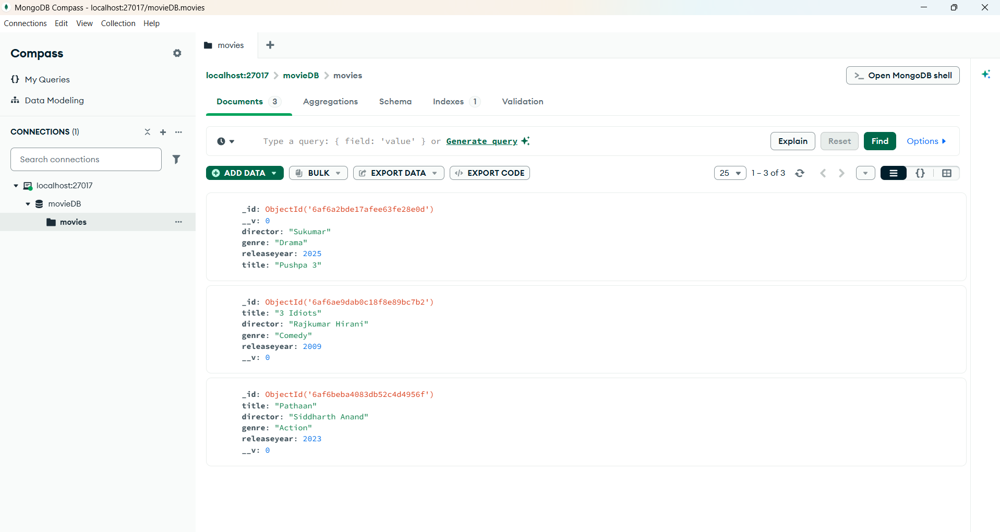

# 🎬 Movie CRUD Operation

A simple Movie Management REST API built using **Node.js, Express.js, MongoDB, and Mongoose**. This project performs CRUD (Create, Read, Update, Delete) operations on movie data.

## 🚀 Technologies Used

- Node.js
- Express.js
- MongoDB
- Mongoose
- Nodemon
- Postman

## ✨ Features

- Add Movie
- Get All Movies
- Get Specific Movie
- Update Movie
- Delete Movie 

## 📁 Project Structure

```
MovieDB-CRUD-project-1/
│
├── app.js
├── package.json
├── package-lock.json
├── Screenshots/
├── README.md
└── node_modules/
```


## 🔹 CRUD Operations

- **Create:** Add a new movie to the database.
- **Read:** Get all movies or find a specific movie.
- **Update:** Update existing movie details using Movie ID.
- **Delete:** Delete a movie using Movie ID.


## 📸 Screenshots

### 🏠 Home Page


### ➕ Add Movie

**---------------------------------------------------------------------**


### 🎬 All Movies

**---------------------------------------------------------------------**


### 🔍 Specific Movie


### ✏️ Update Movie

**---------------------------------------------------------------------**


### 🗑️ Delete Movie

**---------------------------------------------------------------------**



## 📽️ Video Link

https://drive.google.com/file/d/1YA5mLi7Rpt1MR24-7d1Ajqonu4yIN8az/view?usp=sharing